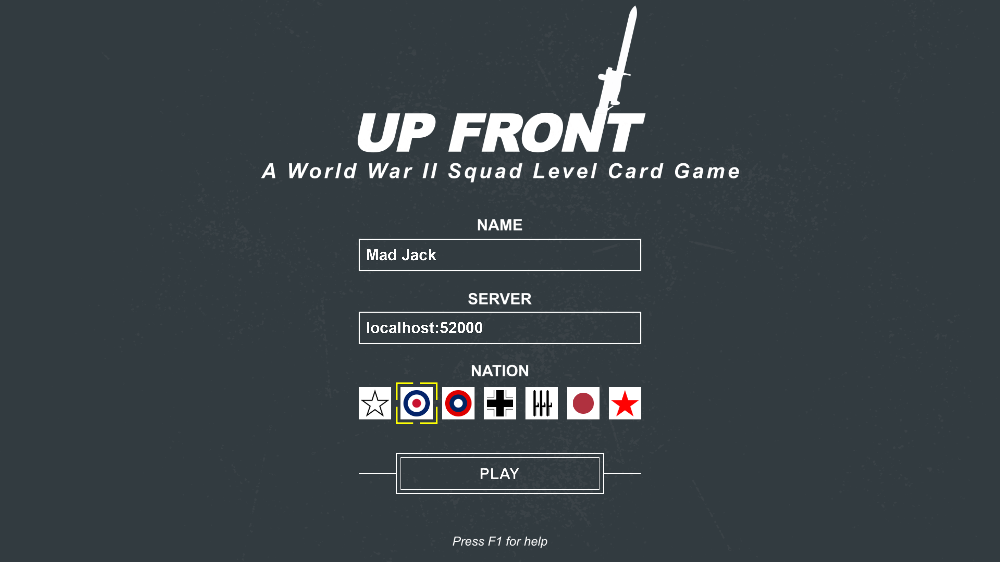
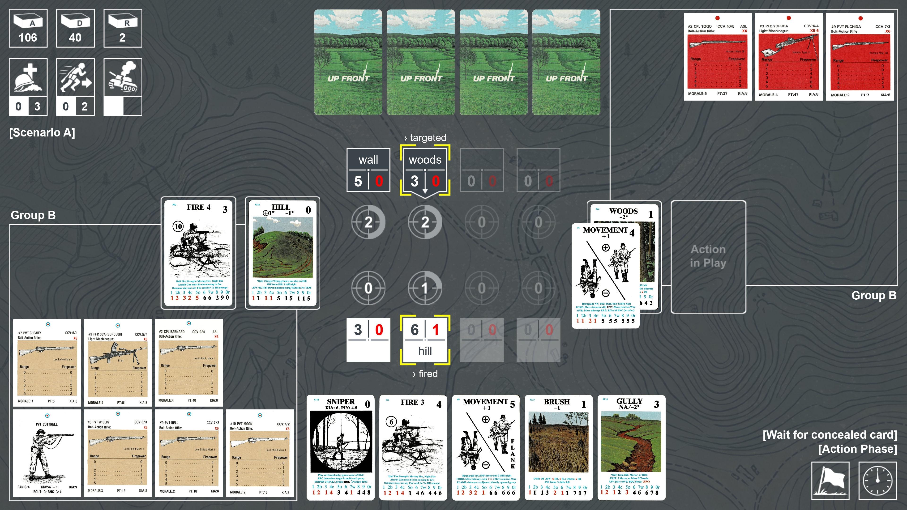

# Up Front

**Up Front** is a two-player card game published in 1983 by Avalon Hill, designed by Courtney F. Allen. It simulates WWII infantry combat (with some armored fighting vehicle support) at the squad level. The game became a cult classic in wargaming circles and spawned two expansions extending it to the North African and Pacific Theaters.

Existing digital adaptations either lack rule enforcement or provide limited visual presentation. This project aims to combine a visually appealing UI with a faithful and complete implementation of the game rules for a smooth, satisfying Up Front experience.

It is designed as a peer-to-peer experience without a central online lobby or matchmaking system. Instead, one player hosts a session locally, while the other player connects directly as a client, enabling private games among friends.

**Launcher:**



**Gameplay:**



## Status

The game is implemented scenario by scenario. Currently, the rules up to chapter 16 (Scenario A of the base game) are implemented.

## Rule Deviations

The following rules are deliberately not implemented, either because they cover rare edge cases or as a design choice:

* **Announcing discards (4.3, 14.5 Q&A):** Discards are resolved one at a time: the opponent decides on a discarded Terrain card immediately, and further discards may follow. They are not announced together before resolution.
* **Wire and Terrain in one discard phase (4.32 Q&A, 13.34):** Terrain is never accepted on a group holding Wire, even if the Wire was discarded in the same phase. Discard the Terrain first, then the Wire.
* **Refill (4.5):** Hands are always refilled to the full hand size; drawing is not optional.
* **Range reset (5.6.2):** The optional reset of range chits at the end of a deck is not used.
* **Aborting an attack (6.5):** The attacker may not cancel an attack after its final strength is known.
* **Rally All for two groups (10.23):** Rally All affects only the active group.
* **Hero (10.4):** Hero cards can only be played during the own turn.
* **Cumulative Smoke and Wire (13.25, 13.6):** A group holds at most one Smoke and one Wire card; a second one is rejected.
* **Losing the Squad Leader (15.2):** The Assistant Squad Leader takes over his role immediately.
* **Deck running out during an attack (16.2):** Action cards played during the current turn stay on the table until the end of the turn and are not shuffled into the new deck.

## Project Structure

```text
up-front/
├── assets/            # Finalized images, sounds, and data tables used directly in the game
├── modules/           # Additional client modules
├── rules/             # Rulebook and scenarios (PDF)
├── sources/           # Working files (e.g. SVG files, promo videos and other editable sources)
├── userdata/          # Unit allocation and local lobby settings
├── cardgame.py        # Main script (Client)
├── cardserver.py      # Main script (Server)
├── start.bat          # Starts a server and two clients (Windows, for testing)
├── requirements.txt   # Python dependencies
├── LICENSE            # MIT License
└── README.md
```

## Getting Started

Open a terminal (Linux/macOS) or command prompt (Windows) in the directory where you want to clone the project. Then:

1. Clone the repository:

   ```bash
   git clone https://github.com/Ultimatthi/up-front
   cd up-front
   ```

2. Install a Python runtime environment (version 3.11 or newer): <https://www.python.org/>

3. Install required dependencies:

   ```bash
   pip install -r requirements.txt
   ```

   On Linux/macOS you may need to use `python3` and `pip3` instead of `python` and `pip`.

## Network Setup

* **Local network (LAN)**: Players can connect directly using the host's local IP address
* **Online play**: The host must configure port forwarding on their router (default port: 52000) and allow the port in their firewall
* **Alternative**: Use virtual LAN solutions like [ZeroTier](https://www.zerotier.com)

## Running the Game

1. Start the server (only 1 player, acting as host):

   ```bash
   python cardserver.py
   ```

2. Start the client (both players, including the host):

   ```bash
   python cardgame.py
   ```

3. Join the game session by connecting to the server at `<host-ip>:<port>`

   * For online play: Use the host's public IP address (e.g., `203.0.113.42:52000`)
   * For local network: Use the host's local IP address (e.g., `192.168.1.10:52000`)
   * For singleplayer, or as the host yourself: Use localhost (e.g., `localhost:52000`)

## License

The source code of this project is licensed under the MIT License. See the [LICENSE](LICENSE) file for details.

## Credits

This project uses or builds upon the following:

* **Arcade** – Open-source Python game development library.

* **Up Front** – Original card game by Courtney F. Allen, published by
  Avalon Hill (1983). This project is an unofficial, non-commercial
  fan adaptation and is not affiliated with or endorsed by Avalon Hill
  or Hasbro. All rights to the original game belong to their respective owners.

## Contributing

Contributions, bug reports, and feature suggestions are welcome!

---

*Made with ❤️ using Python and Arcade.*